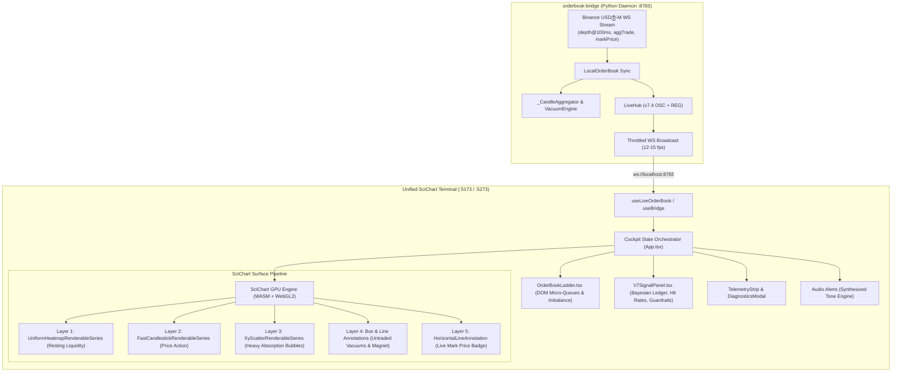

# Engineering Specification: Migration to SciChart.js Institutional Terminal

**Project:** `institution-terminal`  
**Target:** Unified Institutional Microstructure Cockpit  
**Engine:** SciChart.js v6 (C++ WebAssembly + WebGL2 GPU Acceleration)  
**Status:** Ready for Review  
**Author:** Institutional Quant & Platform Engineering Team  

---

## 1. Executive Summary & Objective

The objective of this specification is to define the end-to-end migration of the institutional trading cockpit from the Canvas 2D-based [`trading-terminal`](file:///Users/vireakphol/Documents/GitHub/institution-terminal/trading-terminal) to the hardware-accelerated [`scichart-terminal`](file:///Users/vireakphol/Documents/GitHub/institution-terminal/scichart-terminal).

### The Problem with the Current Canvas 2D Architecture
1. **CPU Saturation at Sub-Second Depth**: The current chart uses Lightweight Charts v5 with an overlay 2D HTML Canvas. While performant for simple line/candlestick series, rendering real-time Bookmap liquidity heatmaps ($240 \times 160$ depth profile tensor) combined with rolling absorption bubbles, dynamic resting walls, and structural annotations consumes up to 75% of single-threaded JavaScript CPU time.
2. **Garbage Collection (GC) Jitter**: Canvas 2D operations allocate multiple path geometries and gradient objects per animation frame. Under high-volatility news events (FOMC, CPI, NFP) where Binance sends depth updates every 65ms, GC pauses cause visual micro-stutters and input lag.
3. **Fragmented Implementations**: Currently, two separate terminal projects exist in the repository: `trading-terminal/` (full feature set, Canvas 2D) and `scichart-terminal/` (ultra-high performance WASM/WebGL, minimal UI).

### The Migration Solution
Merge the complete institutional UX of `trading-terminal` (Signal Ledger, DOM Ladder, Risk Guardrails, Audio Chimes, Layer Toggles, Click Diagnostics) into a single, unified, GPU-accelerated application powered by **SciChart.js v6 WebAssembly / WebGL2**.

---

## 2. System Architecture: Target Topology



---

## 3. Feature Parity & Migration Matrix

| Component / Layer | Canvas 2D ([`trading-terminal`](file:///Users/vireakphol/Documents/GitHub/institution-terminal/trading-terminal)) | SciChart Target ([`scichart-terminal`](file:///Users/vireakphol/Documents/GitHub/institution-terminal/scichart-terminal)) | Status & Migration Strategy |
| :--- | :--- | :--- | :--- |
| **Price Candlesticks** | Lightweight Charts `CandlestickSeries` | SciChart `FastCandlestickRenderableSeries` | **Completed**: Full OHLC history synced with Binance klines. |
| **Liquidity Heatmap** | Custom 2D canvas drawing `ctx.fillRect` / gradients | SciChart `UniformHeatmapRenderableSeries` ($240 \times 160$ matrix) | **Completed**: Native GPU shader texture rendering. |
| **Heavy Absorption Bubbles** | Canvas 2D `ctx.arc` + centered text fill | SciChart `XyScatterRenderableSeries` + `DataLabelProvider` | **Completed**: Red/green bubbles with centered volume ratio numbers. |
| **Liquidity Vacuums (VAC)** | Custom 2D canvas rectangle zones | SciChart `BoxAnnotation` with Relative X Mode | **Completed**: Stretches full width, pinned `VAC3/VAC2` labels. |
| **Vacuum Magnet Line** | Custom 2D canvas dashed cyan line | SciChart `HorizontalLineAnnotation` + axis badge | **Completed**: `MAGNET ↓ 4130.93` live on chart and axis. |
| **Mark Price Line** | Lightweight Charts `createPriceLine` | SciChart `HorizontalLineAnnotation` (`axisLabelFill: #f59e0b`) | **Completed**: Permanent amber axis badge. |
| **DOM Ladder Widget** | [`OrderBookLadder.tsx`](file:///Users/vireakphol/Documents/GitHub/institution-terminal/trading-terminal/src/components/Dashboard/OrderBookLadder.tsx) (25 bids, 25 asks, cumulative depth) | Port to `scichart-terminal/src/components/` | **Phase 3**: Drop-in React component integration. |
| **V7 Signal & Risk Panel** | [`V7SignalPanel.tsx`](file:///Users/vireakphol/Documents/GitHub/institution-terminal/trading-terminal/src/components/Dashboard/V7SignalPanel.tsx) (Wilson CI hit rate, ER, SMPI, Guardrails) | Port to `scichart-terminal/src/components/` | **Phase 4**: Drop-in React component integration. |
| **Interactive Bubble Tooltips** | Click-to-inspect bubble modal with wick math | SciChart `HitTestProvider` / DOM overlay onClick | **Phase 5**: Intercept click on scatter series points. |
| **Audio Engine** | [`alerts.ts`](file:///Users/vireakphol/Documents/GitHub/institution-terminal/trading-terminal/src/lib/alerts.ts) Web Audio API tonal synthesizer | Port `lib/alerts.ts` & sound toggle | **Phase 5**: Direct port. |
| **Tailwind & Theme System** | Dark navy, glassmorphism, responsive density | Merge `tailwind.config.js` and styling | **Phase 1**: Adopt unified styling system. |

---

## 4. Phased Implementation Plan

### Phase 1: Styling System & Asset Infrastructure
* **Goal**: Equip `scichart-terminal` with the production Tailwind design system and theme variables from `trading-terminal`.
* **Deliverables**:
  1. Copy `tailwind.config.js` (semantic tokens: `terminal-bg`, `terminal-surface`, `terminal-panel`, `terminal-border`, `terminal-gold`, `terminal-bull`, `terminal-bear`) to `scichart-terminal/`.
  2. Merge `src/styles/globals.css` into `scichart-terminal/src/index.css`.
  3. Ensure SciChart WASM assets (`scichart2d.wasm`, `scichart2d.data`) remain properly handled by `vite-plugin-static-copy`.

### Phase 2: Enhanced SciChart Controller (`SciChartDeepEngine.ts`)
* **Goal**: Consolidate all chart drawing and interaction features into a robust, leak-free TypeScript class.
* **Key Components**:
  * **Layer Toggles**: Provide dynamic toggling methods:
    ```ts
    setLayerVisibility(layer: "heatmap" | "bubbles" | "vacuum" | "hopla", visible: boolean): void;
    ```
  * **Hopla 3–97 Dealing Range Layer**:
    Render the 3% discount line (`#00b4d8`), Equilibrium 50% line (`#94a3b8`), and 97% premium line (`#ff3b30`) using `HorizontalLineAnnotation`.
  * **Memory & Lifecycle Safety**:
    Ensure `delete()` cleans up WebGL buffers, textures, observers, and event listeners on unmount.

### Phase 3: DOM Ladder & Microstructure Panel Migration
* **Goal**: Mount the Depth of Market (DOM) ladder adjacent to the SciChart canvas.
* **Files to Port**:
  * [`trading-terminal/src/components/Dashboard/OrderBookLadder.tsx`](file:///Users/vireakphol/Documents/GitHub/institution-terminal/trading-terminal/src/components/Dashboard/OrderBookLadder.tsx)
  * Cumulative volume bars, best bid/ask indicators, spread badge, and DOM imbalance meter.
  * Resizable drawer layout allowing the DOM ladder to toggle open/closed with shortcut (`Alt+D`).

### Phase 4: V7 Quantitative Signal Panel & Guardrail Cockpit
* **Goal**: Embed the Bayesian signal ledger, live hit-rate calculator, and environmental guards.
* **Files to Port**:
  * [`trading-terminal/src/components/Dashboard/V7SignalPanel.tsx`](file:///Users/vireakphol/Documents/GitHub/institution-terminal/trading-terminal/src/components/Dashboard/V7SignalPanel.tsx)
  * [`trading-terminal/src/lib/v74.ts`](file:///Users/vireakphol/Documents/GitHub/institution-terminal/trading-terminal/src/lib/v74.ts) (Wilson confidence intervals, Beta(2,2) sample sizes, setup labels).
  * **Environmental Guard Banner**: Visual warning banner when daily loss limit (`-3.95R <= -3R`) or news shock guards trigger.

### Phase 5: Click-to-Inspect Modals, Audio Synthesizer & Telemetry
* **Goal**: Implement precision inspection tooltips and sensory feedback.
* **Deliverables**:
  1. **Bubble Inspection Modal**:
     When a trader clicks on an absorption bubble, display the `🎯 Heavy Absorption Detector` modal showing:
     * Anchor price and timestamp.
     * Rolling volume ratio vs. 20-period SMA (e.g. `130%`).
     * Wick rejection ratio (e.g. `48% upper wick`).
     * Institutional thesis ("Aggressive buyers trapped into resting ask liquidity").
  2. **Web Audio Chimes**:
     Integrate Web Audio tonal chimes (`playChime("LONG")` / `playChime("SHORT")`) triggered on confirmed A+ execution signals.
  3. **Telemetry & Diagnostics**:
     Port [`DiagnosticsPanel.tsx`](file:///Users/vireakphol/Documents/GitHub/institution-terminal/trading-terminal/src/components/Dashboard/DiagnosticsPanel.tsx) showing real-time latency, message counts, and WebGL FPS.

---

## 5. Directory Structure of Unified Application

```
scichart-terminal/
├── public/
│   ├── scichart2d.wasm
│   ├── scichart2d.data
│   └── favicon.ico
├── src/
│   ├── chart/
│   │   ├── TerminalChart.ts         # SciChart WASM/WebGL Engine
│   │   ├── scichart-init.ts         # WASM Context Initializer
│   │   └── chart-layers.ts          # Hopla, Vacuums, & Level Builders
│   ├── components/
│   │   ├── Dashboard/
│   │   │   ├── OrderBookLadder.tsx  # DOM Depth Ladder
│   │   │   ├── V7SignalPanel.tsx    # Quant Signal & Guardrail Panel
│   │   │   ├── DiagnosticsPanel.tsx # Performance & Telemetry Modal
│   │   │   └── AbsorptionModal.tsx  # Click-to-Inspect Bubble Modal
│   │   └── Shared/
│   │       ├── ErrorBoundary.tsx
│   │       ├── Toast.tsx
│   │       └── MetricTile.tsx
│   ├── hooks/
│   │   └── useBridge.ts             # Unified WebSocket Client
│   ├── lib/
│   │   ├── absorption.ts            # Heavy Absorption Detector Engine
│   │   ├── alerts.ts                # Audio Tone Synthesizer
│   │   ├── format.ts                # Institutional Price/Volume Formatter
│   │   ├── klines.ts                # Binance Futures Kline Ingest
│   │   └── v74.ts                   # Bayesian Wilson CI & Probability View
│   ├── types/
│   │   ├── frame.ts                 # Full Terminal Frame Contract
│   │   └── v74.ts                   # Pine v7.4 Engine Schema
│   ├── App.tsx                      # Master Cockpit Layout
│   ├── index.css                    # Design System Tokens
│   └── main.tsx
├── tailwind.config.js
└── package.json
```

---

## 6. Performance Benchmarks & Acceptance Criteria

### 6.1 Quantitative Performance Thresholds
1. **Frame Rate**: Minimum 58 FPS maintained during active market volatility with continuous $240 \times 160$ depth heatmap updates.
2. **Memory Stability**: Zero memory growth over a 4-hour continuous streaming session (verified via Chrome DevTools Heap Snapshots).
3. **Bundle Size**: Initial JS bundle $\le 1.2\text{ MB}$ (gzip: $\le 320\text{ KB}$), excluding WASM binary.
4. **Time to First Render**: Initial chart canvas painted and interactive within $\le 600\text{ ms}$ of page load.

### 6.2 Acceptance Verification Checklist
- [ ] **Candle Rendering**: Accurate historical 200-candle baseline with live candle real-time ticking.
- [ ] **Heatmap Layer**: Visible gradient density profile reflecting real-time Binance L2 resting depth.
- [ ] **Absorption Bubbles**: Clear emerald/crimson markers with centered volume ratio numbers (`80`, `130`, `187`).
- [ ] **Vacuum Pockets & Magnet**: Permanent `VAC3` (`4147.98`), `VAC2` (`4130.93`), and `MAGNET ↓` (`4130.93`) matching the bridge.
- [ ] **Signal Panel**: Complete V7.4 Bayesian signal ledger with honest Wilson CI hit rates and daily loss guardrail banner.
- [ ] **DOM Ladder**: Functional order book depth ladder toggling smoothly on the right dock.
- [ ] **Audio & Feedback**: Audio chimes playing on fresh signals with sound toggle memory.
- [ ] **TypeScript Build**: `pnpm run build` passes with zero errors and zero warnings.

---

## 7. Migration Timeline & Effort Estimate

```
[Day 1] Phase 1: Styling, Tokens & Tailwind Foundation
[Day 2] Phase 2: Enhanced SciChart Controller & Hopla Bands
[Day 3] Phase 3: DOM Ladder & Depth Ingest
[Day 4] Phase 4: V7 Quantitative Signal Panel & Guardrail System
[Day 5] Phase 5: Interactive Bubble Tooltip & Audio Engine
[Day 6] Phase 6: Performance Profiling, Memory Audit & Verification
```
